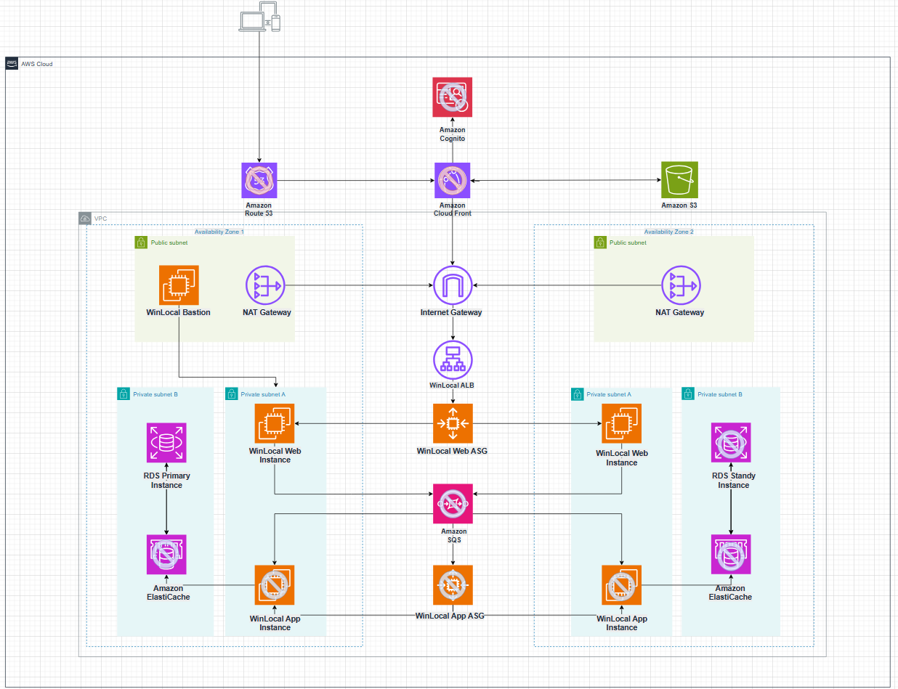
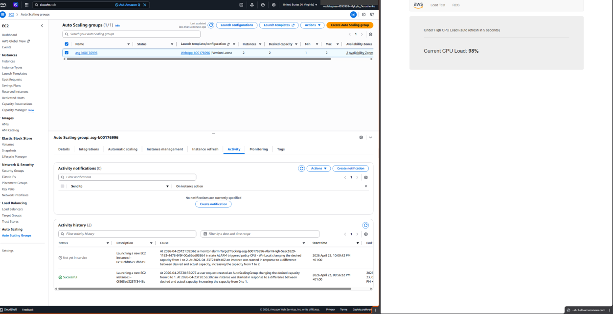

# Secure AWS Migration: WinLocal Giveaways

**Individual project** · Security Architecture (COMP H2701) · BSc Applied Cybersecurity & Digital Forensics, TU Dublin · Apr to May 2026

I designed a secure, highly available AWS architecture for a startup moving off its own servers, then built a working proof of concept in the AWS Academy Learner Lab (us-east-1) and tested it under load.

## The problem

WinLocal Giveaways is a fictional Dublin startup from the module case study. It runs online competitions and wanted to move from on-premises servers to AWS. It had three issues:

- The website went down during traffic spikes.
- The database had no redundancy.
- A ransomware attack had spread easily through their flat network.

## My contribution

I did this project on my own. I:

- designed the full target architecture in draw.io
- built and configured every resource in the proof of concept
- ran the load test
- wrote the report justifying each design decision

## Architecture

The full design runs across two Availability Zones with public and private subnets:

- **Front end:** Route 53, CloudFront and Cognito.
- **Compute:** an Application Load Balancer in front of separate web and app tiers, each in its own Auto Scaling group, with SQS between them.
- **Data:** ElastiCache in front of a Multi-AZ RDS database.
- **Admin access:** a bastion host and NAT Gateways.
- **Fallback:** a static backup site on S3.

Services shown with a crossed-out icon are part of the proposed design but were not built in the proof of concept.

## What I built (proof of concept)

| Requirement | What I built | Evidence |
|---|---|---|
| Network segmentation | VPC across two AZs with public and private subnets, Internet Gateway, NAT Gateway and separate route tables | [VPC resource map](images/02-vpc-resource-map.png) |
| Controlled admin access | Bastion host that only accepts SSH from my IP; web servers only accept SSH from the bastion's security group | [SSH via bastion](images/05-ssh-via-bastion.png) |
| Repeatable builds | Custom AMI of the configured web server, used by the Auto Scaling launch template | (in report) |
| Scalability | Auto Scaling group with a 60% CPU target (min 1, max 2) | [Scale-out under load](images/03-auto-scaling-scale-out.png) |
| Availability | Application Load Balancer sending traffic to instances in us-east-1a and us-east-1b | [ALB across two AZs](images/04-alb-two-azs.png) |
| Least privilege | Separate security group per tier (ALB, web, bastion, RDS); web tier only reachable from the ALB and bastion, MySQL only from the web tier | [Web security group](images/06-web-security-group.png) |
| Database | MySQL on Amazon RDS connected to the web app | [Web app reading from RDS](images/07-optional-rds-web-app.png) |
| Fallback | Static backup website hosted on S3 for when the main app is down | [S3 backup site](images/08-optional-s3-backup-site.png) |

## Results

- **Auto Scaling worked under load.** A load test pushed CPU to 98%. The CloudWatch alarm fired, and the Auto Scaling group launched a second instance in the other AZ.
- **Traffic was balanced across AZs.** Refreshing the load balancer's DNS name returned instances in both us-east-1a and us-east-1b.
- **Direct SSH was blocked.** SSH to the web server only worked by hopping through the bastion.
- **The app tier could use the database.** The web app could read and write to the RDS database through the security-group chain.

## Design decisions I had to justify

- **Five nines availability:** the brief asked for it. I advised against it for now, because it needs a two-region setup that a small startup can't justify on cost.
- **Capped scale-out:** I kept maximum capacity low on purpose. That way, fake traffic can't make the Auto Scaling group launch lots of instances and run up the bill (a "drain the wallet" attack).
- **SQS between tiers:** each tier scales on its own workload, and web servers never talk to app servers directly.
- **Sustainability:** Auto Scaling fits the Well-Architected Sustainability pillar because no servers sit idle. I also suggested Graviton instances and S3 lifecycle rules.

## Tools and services

AWS VPC, EC2, AMI, Auto Scaling, Application Load Balancer, Amazon RDS (MySQL), Amazon S3 static website hosting, CloudWatch alarms, security groups, NAT Gateway; draw.io for the architecture diagram.

## Note

This was built in a temporary AWS Academy lab account that no longer exists. AWS account IDs and IP addresses have been removed from the screenshots.
