# Secure AWS Migration: WinLocal Giveaways

Architecture design for moving a crash-prone giveaway startup onto a secure, highly available AWS
setup. Written for the **Security Architecture** module, BSc Applied Cybersecurity & Digital
Forensics, TU Dublin (Apr to May 2026).

## Architecture Diagram

After thorough consideration of all the requirements and needs of GaveAway I concluded with the following diagram which meets all the requirements and also few enhancements

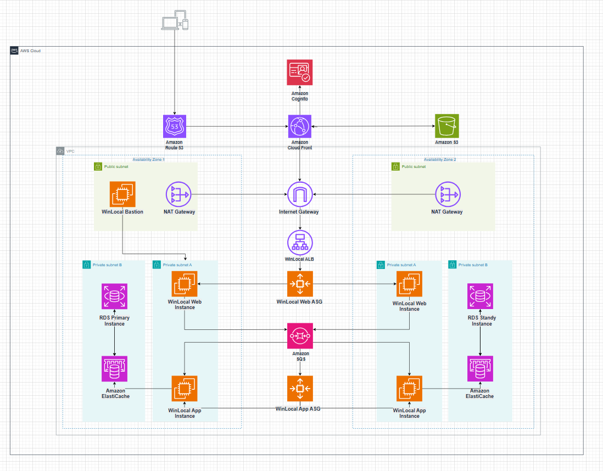

In this architecture we use Route53 as the first service user establishes connection with to access our website which also serves as a link for S3 bucket where our backup website lyes route53 directly connected with cloudfront as the traffic distribution and detection service which serves as a WAF/Traffic Distribution/Cache service that detects malicious traffic and protects from different types of injections and attacks. Then we have Cognito as authentication service. Then we have our application logic which is From CloudFront to Internet Gateway and then Application Load Balancer that distributes traffic between our Availability Zones for a better availability, also we have AutoScaling group in front of our instances for high availability, it dynamically reacts on the spikes of traffic rolling out new instances if required or scaling in if not. We have two separate instances for Web and Application layers. We need two separate types of instances/ASG for budget and security considerations as its not always needed to increase number of backend instances when traffic spikes occur. For that we have Amazon SQS which evenly distributes traffic between backend (Application) instances as well as scaling out and in when needed by having set up CloudWatch alarm when queue reaches certain level. Our app instances communicate with Database instances in different subnets as a result of best practices/requirements meet. Our database layer consists of three elements: ElastiCache at front as the speed and cost saver then RDS instance at the back Standby and Primary which replicates all the data to the standby.

We also have bastion and NAT Gateway in a public subnet for the private instance and internet access

### Task 2 POC

### Networking Design

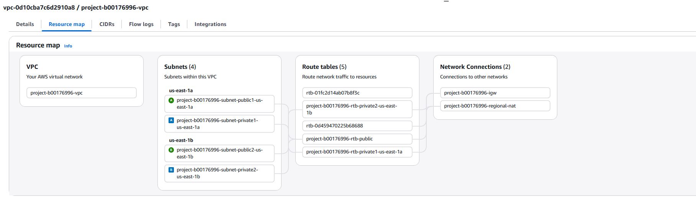

### Bastion Host

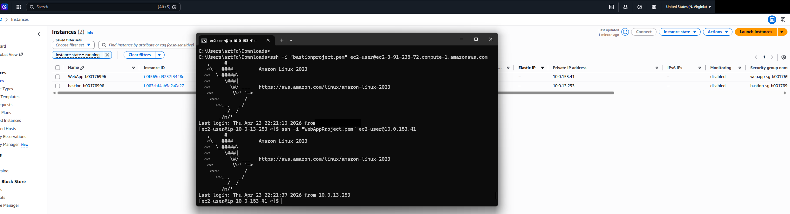

### Amazon Machine Image (AMI)

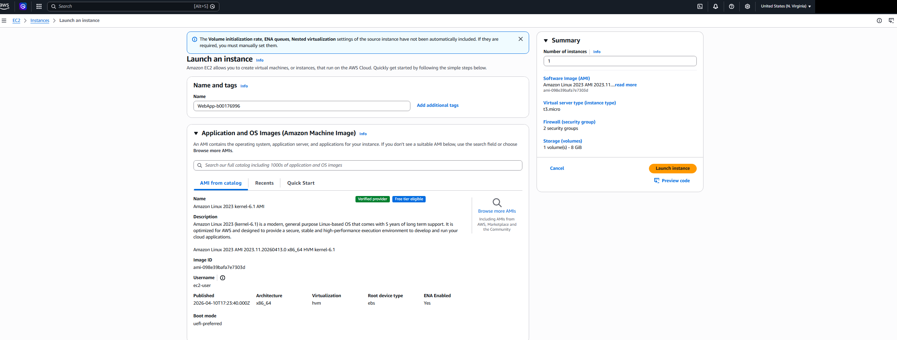

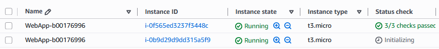

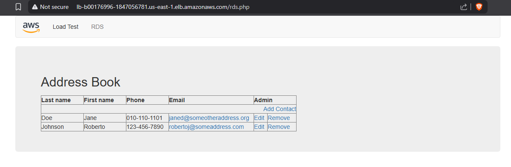

### Single-AZ Amazon RDS Deployment

### Auto Scaling Configuration

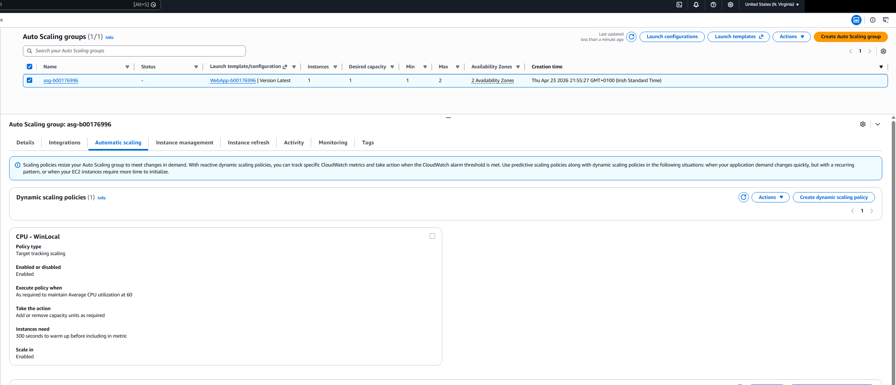

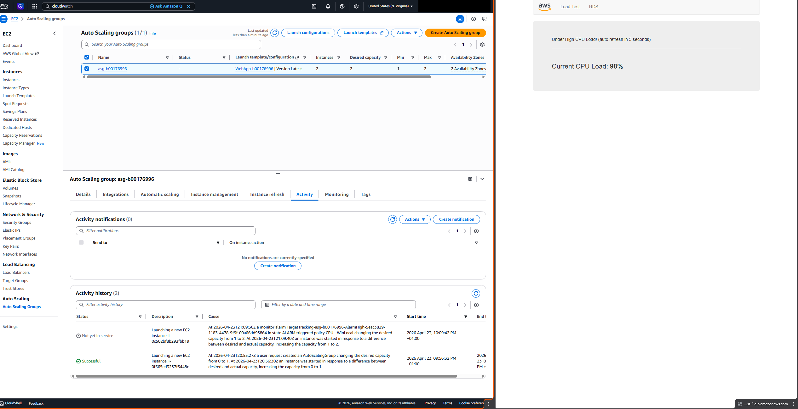

### Evidence of scaling policy occurring

### Load Balancer configuration

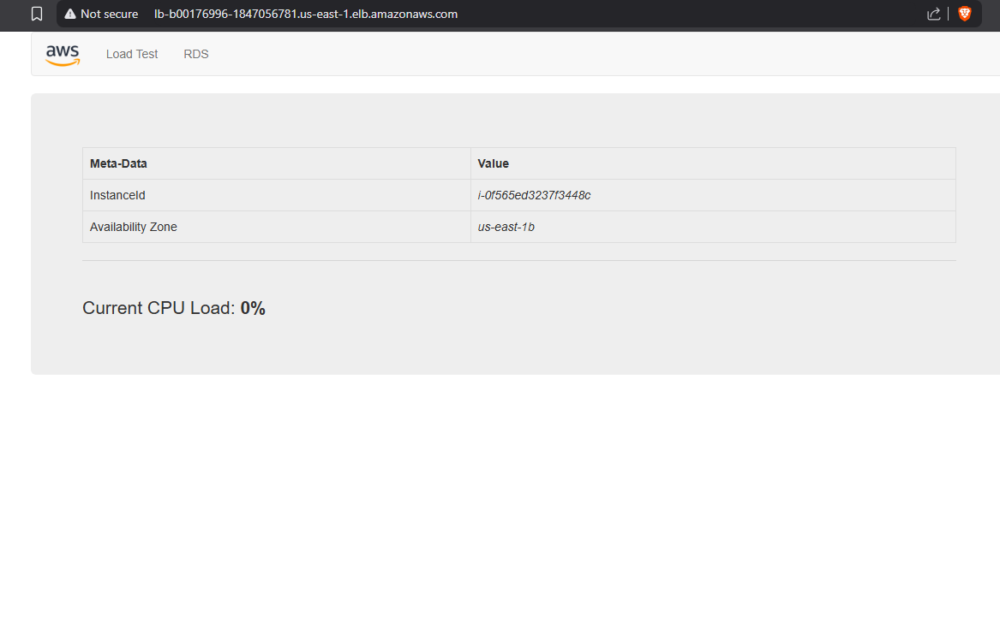

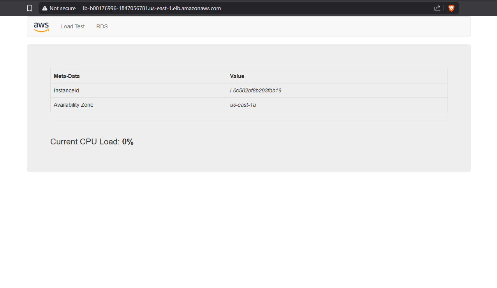

### Sec implementation

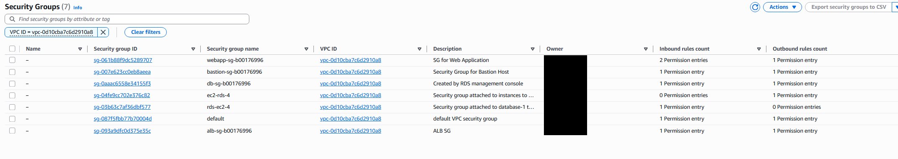

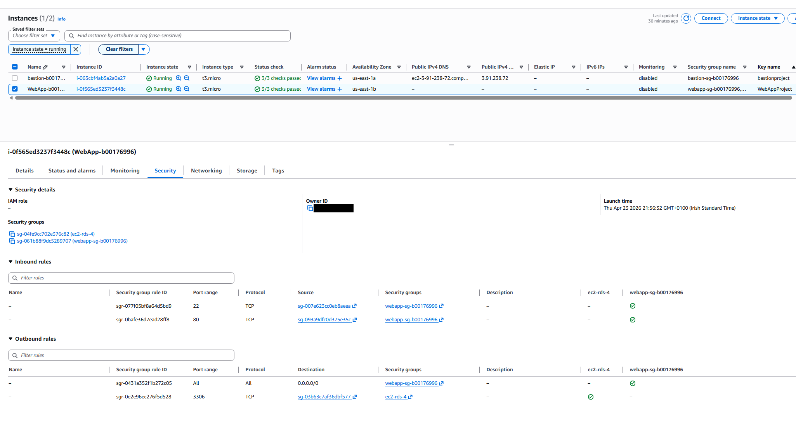

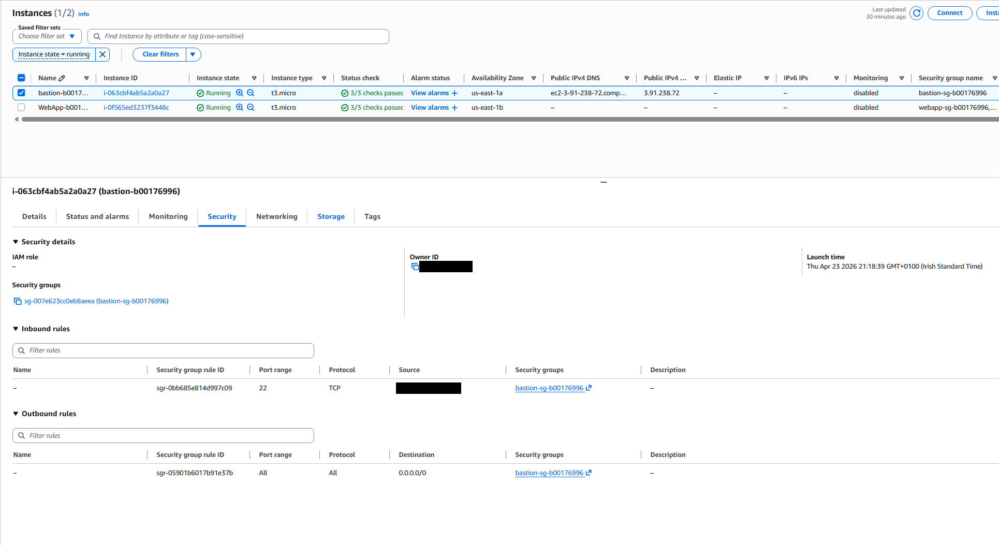

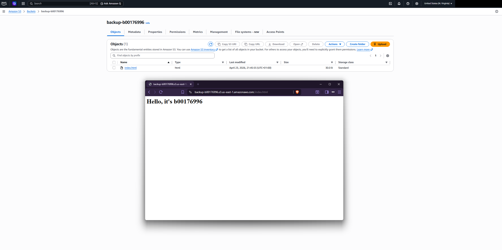

### Static Backup Website
